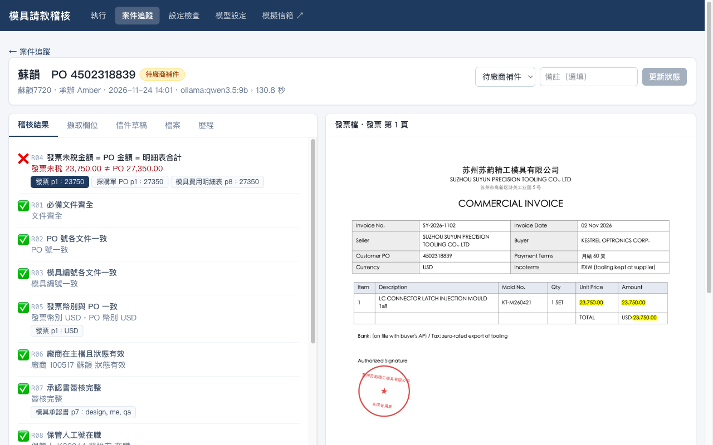
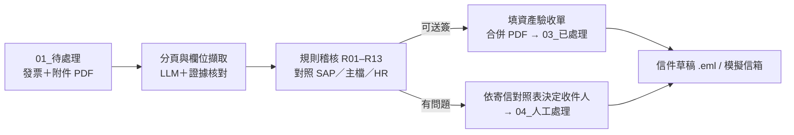
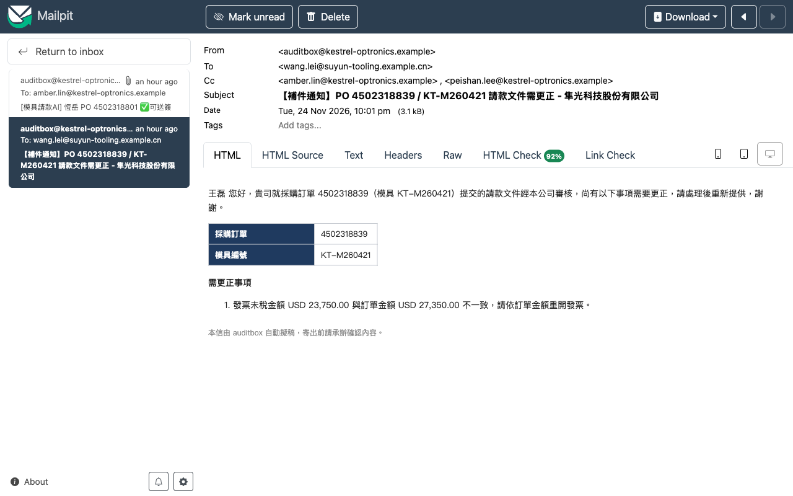
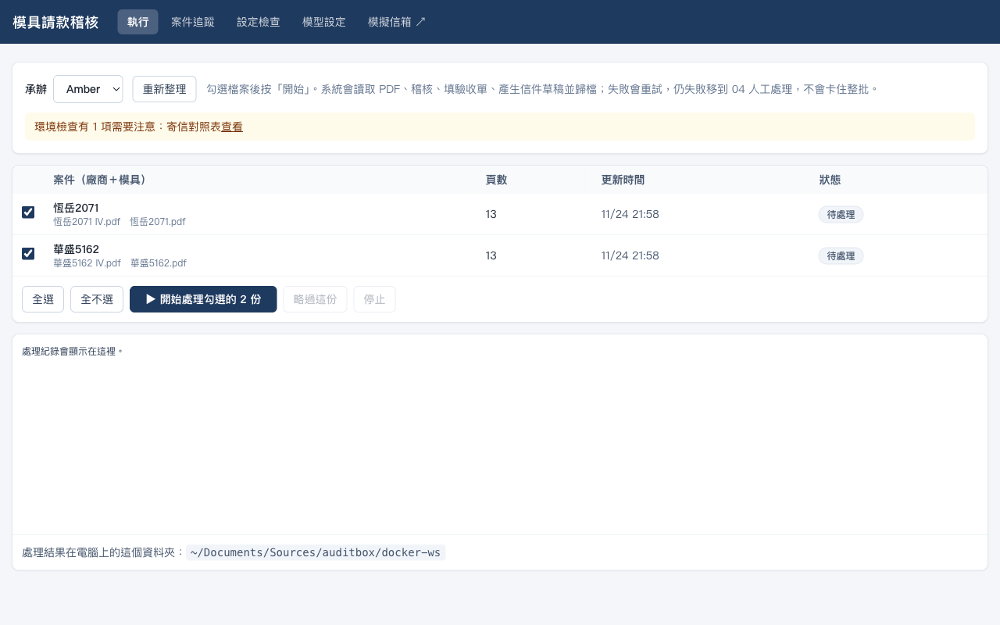

# auditbox｜模具請款 AI 稽核

**把採購每天「對文件、算金額、查該寄給誰、寫信」的工作，變成按一個按鈕。**

廠商請款時會寄來發票與一整包附件（PO、承諾書、承認書、規格書、保管單、費用明細）。auditbox 讀取這些 PDF，
對照 SAP 匯出與主檔逐項稽核；沒問題就自動填好資產驗收單、通知承辦送簽，有問題就依「寄信對照表」寄補件信給該負責的人。

> 專案內所有公司、廠商、人員與單據都是虛構的展示資料。

## 解決什麼問題

| 原本的人工流程 | auditbox |
|---|---|
| 每份請款要翻 10–20 頁 PDF，逐一核對 PO 號、模具編號、金額、幣別、簽核 | 13 條稽核規則自動檢查，每個判斷都附「第幾頁、原文哪一句」的證據 |
| 金額要對 SAP PO、GR、明細表，還要查有沒有重複請款 | 自動比對 SAP 匯出、應付帳款與已處理紀錄 |
| 資產驗收單手動抄 20 個欄位 | 依欄位對照表自動填入 xlsx，並與原始文件合併成一份送簽 PDF |
| 出問題時要去共用的對照表找「這種狀況寄給誰」，表格常有人寫錯 | 依廠商、產品線、異常類型自動決定收件人，並健檢對照表本身的錯誤 |
| 補件信每封重寫，簡繁、中英混用 | 依廠商語言產生繁中或英文信，存成 Outlook 草稿，承辦確認後才寄出 |

## 運作方式

**AI 只負責「從 PDF 抄出欄位」，能不能送簽一律由程式規則判斷。** 每個抄出來的值都要附頁碼與原文引句，
系統會回頭到 PDF 核對，對不上的會標示出來，不會讓 AI 的猜測直接進到結果裡。

## 重點技術

- **文件擷取**：PyMuPDF 讀文字與影像；標題關鍵字分頁、無標題頁交給 LLM 判斷；JSON Schema 結構化輸出＋逐欄位證據核對
- **可切換的 LLM**：Claude API（Opus／Sonnet／Haiku 5.5）或本機 Ollama（qwen3.5:9b），在畫面上切換；API key 只存在本機，不進共用資料夾
- **規則引擎**：13 條可設定的稽核規則，結果分成可送簽／待廠商補件／內部處理／主檔維護
- **寄信路由**：多條件比對（異常類型 × 廠商 × 產品線），最具體的規則優先，並自動健檢對照表（重複、衝突、離職人員、錯誤 email）
- **信件**：範本為主，LLM 只寫開頭段落，且有數字、性別稱謂、長度檢查；系統產出一律繁體（OpenCC）
- **介面**：FastAPI＋Next.js 16 靜態輸出；案件追蹤、PDF 證據螢光標示、信件預覽、環境健檢
- **部署**：Docker Compose 一鍵啟動系統與 Mailpit 模擬信箱
- **評測**：12 件標準答案（160 頁、416 欄位）自動評分，比較準確率、速度與成本

## 評測結果

| 模型 | 欄位正確 | 每件時間 | 每件費用 |
|---|---|---|---|
| Claude Opus 5.5 | 416/416 | 約 27 秒 | 約 USD 0.11 |
| Claude Haiku 5.5 | 416/416 | 約 20 秒 | 約 USD 0.003 |
| qwen3.5:9b（本機 Ollama） | 416/416 | 約 130 秒 | 0 |

詳見 [評測說明](docs/evaluation.md)。

## 快速開始

需要先安裝並打開 [Docker Desktop](https://www.docker.com/products/docker-desktop/)。

- Windows：雙擊 `start.bat`
- macOS／Linux：`./start.sh`

完成後會自動開啟：

| 服務 | 網址 | 用途 |
|---|---|---|
| 系統 UI | http://localhost:8765 | 執行稽核、案件追蹤、設定檢查、模型設定 |
| 模擬信箱 | http://localhost:8025 | 系統寄出的信都在這裡，不會寄到外部 |

第一次啟動會放入 12 件展示資料。到「模型設定」輸入 Claude API key（或改用本機 Ollama）後，選承辦、按「開始處理」即可。

## 文件

- [架構與設計決策](docs/architecture.md)
- [稽核規則、寄信路由與信件](docs/rules-and-mail.md)
- [設定與工作區](docs/configuration.md)
- [評測](docs/evaluation.md)
- [開發](docs/development.md)
