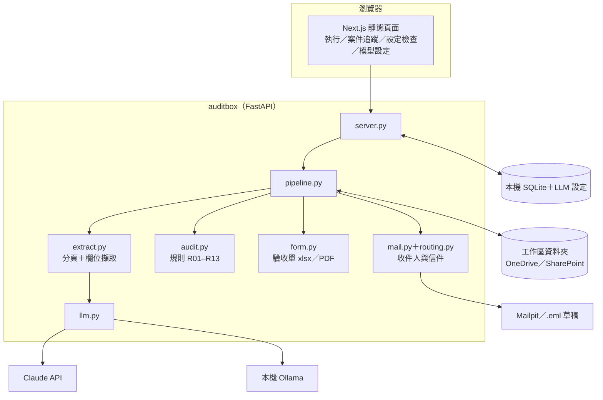

# 架構與設計決策

## 元件

| 模組 | 職責 |
|---|---|
| `extract.py` | 讀 PDF、分頁歸類、呼叫 LLM 擷取欄位、正規化並核對證據 |
| `reference.py` | 讀廠商主檔、SAP PO／GR、應付帳款、HR 名單 |
| `audit.py` | 13 條規則與結果分類 |
| `form.py` | 依欄位對照表填驗收單 xlsx，產生驗收單頁並合併 PDF |
| `routing.py` | 讀寄信對照表、決定收件人、健檢對照表 |
| `mail.py` | 組信件內容、LLM 開頭段落與檢查、輸出 .eml、送 Mailpit |
| `pipeline.py` | 單件流程：配對檔案 → 擷取（含重試）→ 稽核 → 產出 → 歸檔 |
| `server.py` | HTTP API、背景批次、PDF 頁面螢光圖、模型設定 |
| `localstore.py` | 本機資料庫與 LLM 設定的位置 |
| `zh.py` | 系統產出統一轉成繁體 |

## 單件處理流程

1. **配對**：`01_待處理/<承辦>/` 下的 `XXX IV.pdf`（發票）與 `XXX.pdf`（附件）成對；缺一個就標示出來，不處理。
2. **分頁**：每頁先看前幾行有沒有標題關鍵字（發票、採購單、承諾書…），沒有標題或是掃描頁才交給 LLM 判斷，並支援「延續上一頁」。
3. **擷取**：每種文件一次呼叫，用 JSON Schema 限定輸出；承認書、承諾書與掃描頁會附上頁面影像（要看簽名與印章）。
4. **正規化與核對**：日期、金額、幣別、PO 號、工號統一格式；每個值都要附頁碼與原文引句，系統回到該頁文字核對。
5. **稽核**：13 條規則逐一判斷，依負責方決定結果分類。
6. **產出**：可送簽 → 填驗收單、合併 PDF，移到 `03_已處理`；其他 → 移到 `04_人工處理`。兩者都產生信件草稿、`稽核結果.md` 與 `case.json`。
7. **失敗處理**：擷取失敗會重試；仍失敗則移到 `04_人工處理/<承辦>/系統失敗_*` 並寫明原因，不會卡住整批。

## 設計決策

**AI 只抄欄位，不做判斷。** 金額是否相符、文件是否齊全、該寄給誰，全部由程式規則決定。
LLM 出錯的影響因此被限制在「抄錯一個值」，而抄錯的值通常會和 SAP 比對不上，結果是多一封需要人看的信，而不是讓錯誤通過送簽。

**每個值都要有證據。** 擷取結果包含頁碼與原文引句，系統用正規化後的字串（全形半形、簡繁、破折號統一）回到 PDF 核對。
介面上可以直接看到原文頁面，並以螢光標出該值。

**資料留在原本的資料夾。** 工作區就是部門共用的 OneDrive／SharePoint 同步資料夾，處理結果直接歸檔在裡面，不另建資料庫給大家共用。
重複請款的檢查會掃描 `03_已處理` 裡的 PO 資料夾，所以同部門不同人處理過的案件也查得到。

**個人資料不放共用區。** 案件索引（SQLite）與 API key 放在每台電腦自己的資料夾（Docker 則是 volume），API key 檔案權限 600，畫面只顯示前後幾碼。

**信件不直接寄出。** 一律產生草稿（`.eml` 帶 `X-Unsent: 1`，Outlook 開啟即為可編輯草稿），展示環境則送到 Mailpit 模擬信箱。

**系統產出一律繁體。** 大陸廠商的原始文件保留簡體（這是真實輸入），比對時先統一轉成繁體；信件、驗收單、資料夾名稱都輸出繁體。
